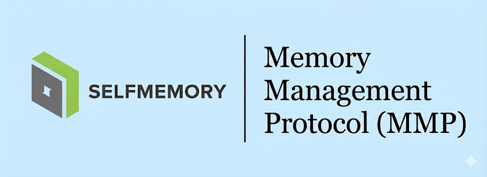

[](https://github.com/SelfMemory/SelfMemory/actions/workflows/ci.yml)
[](https://pypi.org/project/selfmemory/)
[](https://pypi.org/project/selfmemory/)
[](https://pypi.org/project/selfmemory/)
[](https://www.npmjs.com/package/@selfmemory/sdk)
[](https://github.com/SelfMemory/SelfMemory/blob/master/LICENSE.txt)
[](https://codecov.io/gh/SelfMemory/SelfMemory)

# SelfMemory

**A scoped, multi-tenant knowledge wiki that an agent maintains for your organization.**

People drop in documents. An agent reads each one once and files it into a
maintained wiki, and later questions are answered from that wiki with
citations. Knowledge is kept per organization in four kinds of scope:

| Scope | Who reads it | Who writes it |
| --- | --- | --- |
| Org room (`org`) | every member | org owner and admins (via promotion review) |
| Project (`project:<id>`) | project members with `canRead` | members with `canWrite` |
| Sub-project | its own members only, never its parent's | its own writers |
| Personal notes (`user:<id>`) | that person | that person |

## How it works

```
upload ──▶ raw/<scope>/…        immutable sources (PDF, DOCX, PPTX, XLSX, HTML → markdown)
             │
             ▼  ingest run (opencode agent, sandboxed to this scope)
           wiki/<scope>/…        Open Knowledge Format pages, one git repo per scope
             │
             ▼  query run (read-only agent) ──▶ answer with page citations
```

- **All model work is done by [opencode](https://opencode.ai)**, run once per
  job. The server makes no LLM calls and has no vector store or embeddings.
- **Each run is confined** to the directories its caller may read: bubblewrap
  on Linux, docker/podman elsewhere. The boundary is verified by a probe on the
  host before any agent starts, and in production an unverified sandbox
  refuses every run.
- **Facts never flow upward silently.** An ingest into a project that finds an
  org-wide fact queues it in that scope's `promotions.md`; an org admin approves
  it into the org room.
- **Runs are durable jobs** in MongoDB, streamed over server-sent events, and
  resumable. Any number of API processes and workers share the queue.
- **The wiki is browsable**: a page tree, a link graph, and a timeline of how
  the graph grew, commit by commit.

## Run it locally

```bash
make install-dev
docker compose -f deploy/docker-compose.yml up -d mongodb   # tenancy + run queue
make run                          # API on :8081, worker in-process
uv run python scripts/dev_seed_api_key.py   # prints an API key + project id
```

```bash
curl -H "Authorization: Bearer $KEY" -F scope=project:$PROJECT \
     -F files=@notes.pdf localhost:8081/api/v1/wiki/upload
curl -H "Authorization: Bearer $KEY" -H 'Content-Type: application/json' \
     -d '{"command":"query","message":"What did we decide?"}' \
     localhost:8081/api/v1/wiki/runs
```

The agent needs model credentials: an API key in the environment
(`ANTHROPIC_API_KEY`, `OPENAI_API_KEY`, `OPENROUTER_API_KEY`, …) or
`HOME=$SELFMEMORY_AGENT_HOME opencode auth login`. See `.env.example`, the
Bruno collection in `bruno/`, and `make isolation` to see which sandbox this
host can provide.

## Layout

One domain core, exposed through REST (versioned under `/api/v1`) and MCP;
see [`docs/architecture/index.html`](docs/architecture/index.html) for the
blueprint.

```
packages/selfmemory/src/selfmemory/
  config.py, wiki_settings.py   typed settings (pydantic-settings)
  kernel/       pure helpers: path safety, ids, validators, feature registry
  features/     one folder per capability: wiki, runs, uploads, tenancy, api_keys
                (domain / adapters / service / interfaces inside each)
  platform/     cross-cutting adapters: mongo, ory, sandbox, telemetry, mcp
  apps/         process entry points: api.py, worker.py, mcp.py
deploy/         docker compose, sandbox image
tests/          unit/<feature>/, integration/
```

`make lint` also runs import-linter, which enforces that dependencies point
downward (apps → features → platform → kernel) and that the wiki domain stays
free of I/O.

## MCP

`selfmemory.apps.mcp` (`make run-mcp`) exposes the wiki to MCP clients (OAuth 2.1 via Ory Hydra, or
an API key): `search`, `fetch`, `wiki_tree` and `ask`. Each call carries the
caller's own credential, so it sees exactly what that caller may read.

## 📚 Full Documentation

**Visit [docs.selfmemory.com](https://docs.selfmemory.com) for complete documentation, guides, and examples.**

**Changelog**: See [CHANGELOG.md](CHANGELOG.md) for a detailed list of changes and updates.

## 🤝 Contributing

We welcome contributions! [CONTRIBUTING.md](CONTRIBUTING.md).

## 🔗 Links

- **Discord**: [discord.com/invite/selfmemory](https://discord.com/invite/YypBvdUpcc)
- **Brand Assets** (Logos, Slides, etc.): [Storage Link](https://drive.google.com/drive/folders/1paB9DkpPGv58_MC3P5C1el_Bw7lzYh-3?usp=sharing)
